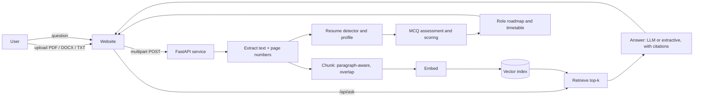

# DocMind: RAG Pipeline, Career Assessment and Website Plan

## 1. Goals and success measures

| Goal | Measure of success |
|---|---|
| Answer questions about any uploaded document | Retrieval recall@4 ≥ 0.85 on a labelled set; 0 answers without a citation |
| Refuse when the document does not contain the answer | ≥ 90% refusal on out-of-scope questions |
| Personalise an assessment to a resume | ≥ 90% of claimed skills are detected correctly on a 30-resume test set |
| Give actionable guidance | Every topic scoring below 100% shows a specific next action |
| Produce a realistic learning plan | Timetable hours match the user's stated budget exactly; milestones per phase |
| Look and perform like a professional product | Lighthouse ≥ 95 for performance, accessibility, best practices and SEO |

## 2. Architecture



Components:

- **Extraction** (`backend/app/ingest.py`): pypdf for PDF (page-aware), python-docx for DOCX (paragraphs and tables), plain decoding for TXT and MD. Scanned PDFs are rejected with a clear message until OCR is added.
- **Chunking**: paragraph-first splitting, ~900 characters, 150-character overlap, starting each overlap on a whole word. Every chunk keeps its page number.
- **Embeddings**: an offline hashed uni- and bi-gram embedder ships by default, so the system runs with no keys or downloads. It sits behind the `embed(texts) -> matrix` interface, so a neural model can replace it without touching retrieval.
- **Retrieval**: cosine similarity over a normalised matrix, top-k, document filter. Relevance threshold 0.05 separates "found" from "not found".
- **Answering**: with `ANTHROPIC_API_KEY` and `ANTHROPIC_MODEL` set, a hosted LLM answers from numbered context and cites it. Without them, an extractive answer returns the sentences that best match the question, with sources.
- **Resume intelligence** (`resume.py`, `knowledge.py`): detects resumes from section headings and contact details. Extracts name, years of experience, education, experience lines and skill topics.
- **Assessment** (`assessment.py`): multiple-choice only. Topics the resume claims get two questions. Unclaimed topics get one probe question, which finds gaps the candidate did not state.
- **Roadmap** (`roadmap.py`): five role tracks, each with three weighted phases. Weeks are allocated proportionally. Assessment gaps move to the front of the plan.
- **Web** (`web/`): a static, dependency-free single page, served by the same FastAPI app.

## 3. RAG pipeline: decisions and production upgrades

| Stage | Built now | Production upgrade | Why |
|---|---|---|---|
| Parse | pypdf, python-docx | Unstructured or Docling, with OCR (Tesseract or a cloud OCR) for scans | Tables and layout matter for resumes and reports |
| Chunk | Paragraph-aware, 900 chars, 150 overlap | Section-aware chunks, parent-child retrieval | Keeps headings with their content |
| Embed | Hashed n-grams (offline) | A neural embedding model, batched, cached by content hash | Better paraphrase recall |
| Store | In-memory NumPy matrix | pgvector or Qdrant, with metadata filters | Persistence, multi-user, scale |
| Retrieve | Dense top-k | Hybrid (BM25 + dense) with reciprocal-rank fusion, then a cross-encoder re-ranker | Exact terms (IDs, names) plus meaning |
| Generate | Extractive, or LLM with numbered citations | LLM with a strict citation schema and a faithfulness check | No unsupported claims |
| Observe | Health endpoint | Traces per query (retrieved chunks, latency, tokens), feedback thumbs | Finds failures in production |

Ingestion is idempotent: the planned production version keys documents by content hash, so re-uploading the same file reuses its index entries.

## 4. Evaluation

1. **Golden set**: 50 question–answer pairs across 10 documents, each answer labelled with its source page.
2. **Retrieval metrics**: recall@4, MRR, and a check that the cited page is the gold page.
3. **Generation metrics**: faithfulness (every claim supported by a cited chunk) and refusal accuracy on 20 out-of-scope questions.
4. **Assessment metrics**: skill-detection precision and recall on 30 labelled resumes; agreement between the level and the score bands.
5. **Regression gate**: CI fails if recall@4 drops by more than 3 points against the saved baseline.

## 5. Resume assessment design

Flow: upload → resume detection → personalised MCQ set → scoring → guidance → **final question: which role do you want?** → roadmap.

Scoring rules:

- Overall levels: ≥ 80% *Strong*, 50–79% *Developing*, < 50% *Needs foundation*.
- Per-topic percentage. Any topic below 100% gets specific guidance.
- A topic the resume claims but the candidate misses is flagged **claimed but unverified**. This is the most useful signal for interviews.
- Each wrong answer shows the correct option and a one-line explanation.

Guidance is attached to the topic, not generic. It names a concrete project to build, such as "containerize one app and add a CI pipeline."

Roadmap design: five tracks (Data Analyst, ML Engineer, Backend Engineer, Frontend Engineer, DevOps/Cloud). Each track has three phases with a deliverable per phase. The user sets total weeks (4–26) and hours per week (2–40). The timetable lists every week with its focus, hours and milestones. Assessment gaps appear as "Shore up: …" at the start of their matching phase.

Planned extension: generate questions from the resume text with an LLM (the knowledge bank stays as a fallback), and add a practice-interview mode.

## 6. Website plan

**Information architecture**: Hero → How it works → 1. Upload → 2. Ask → 3. Assessment → 4. Role and roadmap → FAQ → Footer. The order follows the user's path, and the roadmap ends on the role question you asked for.

**Visual system**: a single indigo accent on neutral surfaces. Colour is defined as tokens on `:root`, with dark mode from both `prefers-color-scheme` and an explicit `data-theme` override. System font stack keeps the page fast without external requests.

**Accessibility (WCAG 2.1 AA)**
- Skip link, landmark regions, one `h1`, ordered headings.
- Every form control has a label. Quiz questions use `fieldset` and `legend`.
- Focus rings are visible. Status messages use `aria-live`. Table has a caption and scoped headers.
- Motion is disabled under `prefers-reduced-motion`. Layout works at 320px with no horizontal page scroll (except the timetable, which scrolls inside its own container).

**Search ranking and discoverability**
- Unique `<title>` and meta description. Canonical URL. Open Graph and Twitter card tags.
- JSON-LD `WebApplication` schema. Semantic HTML with one `h1` and a logical outline.
- `robots.txt` and `sitemap.xml` shipped in `web/`. Replace `example.com` with the real domain before launch.
- Core Web Vitals: no render-blocking third-party scripts, the script is `defer`, no web fonts, no layout shift from images (none used).
- Content: the FAQ answers real questions people search for ("does it train on my documents", "how is the score calculated").

**Performance budget**: under 40 KB of total CSS, JavaScript and HTML before gzip. Largest contentful paint under 1.5 s on a mid-range phone over 4G.

## 7. Security and privacy

- Upload limit 10 MB, allowed extensions checked on the server, not only in the browser.
- All user text is inserted with `textContent`, never `innerHTML`, which blocks stored XSS from document content.
- PDFs are parsed in-process. Production should run parsing in a sandboxed worker with a timeout and memory cap, since PDF parsers have a history of malformed-file bugs.
- Documents are held in memory and never used for training. Production adds a delete endpoint, a retention window (for example 24 hours), and encryption at rest.
- Resumes contain personal data. Logs must not record document text. The production build needs a privacy notice and consent before upload.
- Rate limiting on upload and ask endpoints. The LLM key stays server-side only.
- Quiz answer keys never leave the server. The public view strips them.

## 8. Delivery plan (timeline)

| Week | Milestone | Exit criteria |
|---|---|---|
| 1 | Pipeline core: extract, chunk, embed, retrieve | Unit tests pass; recall check on 10 docs |
| 2 | LLM answering with citations and refusal | Faithfulness ≥ 90% on golden set |
| 3 | Resume detection, profile, MCQ assessment and scoring | 30-resume detection set passes |
| 4 | Roadmap engine and timetable | Hours match budget; all role tracks pass tests |
| 5 | Website: design system, accessibility pass, responsive layout | Lighthouse ≥ 95; keyboard-only walkthrough passes |
| 6 | Persistence (pgvector), auth, rate limits, deletion endpoint | Load test at 50 concurrent users; retention job verified |
| 7 | Evaluation harness in CI, observability, deploy | Regression gate active; dashboards live |
| 8 | Beta with 20 users, feedback loop, fixes | Task success ≥ 80%; SUS score ≥ 70 |

## 9. Known limitations of this first version

- The default embedder is lexical. It misses paraphrases that a neural model would catch.
- The index is in memory and single-process. Restarting clears uploaded documents.
- The assessment uses a starter bank of 16 questions. Scale it with more items per topic, and add LLM-generated questions from resume text.
- Scanned PDFs are not supported until OCR is added.

## 10. Running it

```bash
cd backend
python -m venv .venv && source .venv/bin/activate
pip install -r requirements.txt
pytest -q tests
uvicorn app.main:app --reload        # open http://127.0.0.1:8000
```

Optional LLM answers: set `ANTHROPIC_API_KEY` and `ANTHROPIC_MODEL` before starting the server.
