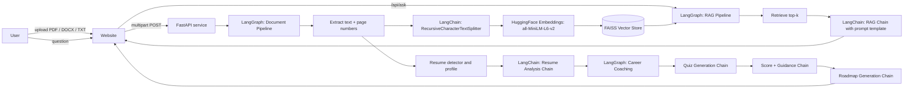

# DocMind: RAG Pipeline, Career Assessment and Website Plan

## 1. Goals and success measures

| Goal | Measure of success |
|---|---|
| Answer questions about any uploaded document | Retrieval recall@4 ≥ 0.85 on a labelled set; 0 answers without a citation |
| Refuse when the document does not contain the answer | ≥ 90% refusal on out-of-scope questions |
| Personalise an assessment to a resume | ≥ 90% of claimed skills are detected correctly on a 30-resume test set |
| Give actionable guidance | Every topic scoring below 100% shows a specific next action |
| Produce a realistic learning plan | Timetable hours match the user's stated budget exactly; milestones per phase |
| Look and perform like a professional product | Lighthouse ≥ 95 for performance, accessibility, best practices and SEO |

## 2. Architecture



## 3. Technology stack

| Layer | Technology | Purpose |
|---|---|---|
| Framework | **LangChain** | Chains, prompts, output parsers, vector store integration |
| Orchestration | **LangGraph** | State-machine workflows for document processing, RAG, coaching |
| Embeddings | **HuggingFace** (`all-MiniLM-L6-v2`) | Free, local, no API key — semantic search |
| Vector store | **FAISS** | Fast similarity search |
| LLM | **Anthropic Claude** (via LangChain) | Answering, resume analysis, quiz gen, guidance, roadmaps |
| Text splitting | **LangChain** `RecursiveCharacterTextSplitter` | Paragraph-aware chunking |
| API | **FastAPI** | REST endpoints |
| Web | Static HTML/CSS/JS | No build tools, dependency-free |

## 4. Configuration: single source of truth

All API keys and settings live in **`backend/app/config.py`**. The app reads
environment variables once:

```
ANTHROPIC_API_KEY     → LLM (optional — app works without it)
ANTHROPIC_MODEL       → Which Claude model to use
EMBEDDING_MODEL       → HuggingFace model name (default: all-MiniLM-L6-v2)
EMBEDDING_DEVICE      → cpu or cuda (default: cpu)
CHUNK_SIZE            → Characters per chunk (default: 900)
CHUNK_OVERLAP         → Overlap between chunks (default: 150)
RETRIEVAL_K           → Number of chunks to retrieve (default: 4)
SCORE_THRESHOLD       → Minimum similarity to consider a hit (default: 0.05)
```

To switch models or keys, change the env var — no code changes needed.

## 5. Prompt templates (`backend/app/prompts.py`)

Each pipeline stage has a dedicated `ChatPromptTemplate`:

| Prompt | Stage | What it does |
|---|---|---|
| `RAG_PROMPT` | Q&A | Answers from numbered context with citations |
| `RESUME_ANALYSIS_PROMPT` | Resume upload | Extracts structured profile JSON |
| `QUIZ_GENERATION_PROMPT` | Assessment | Generates personalised MCQs per skill |
| `GUIDANCE_PROMPT` | Scoring | Provides per-topic study advice |
| `ROADMAP_PROMPT` | Roadmap | Generates phased learning plan JSON |

## 6. LangGraph workflows (`backend/app/graph.py`)

Three compiled state graphs:

1. **Document Processing Graph**: `ingest → [is_resume?] → enhance_profile → done`
2. **RAG Answering Graph**: `retrieve → [has_hits?] → llm_answer / extractive_answer → done`
3. **Career Coaching** (node functions): `build_quiz → score_quiz → build_roadmap`

Each graph falls back gracefully when the LLM is not configured.

## 7. Fallback design

The app works at three levels:

| Level | What you need | What you get |
|---|---|---|
| **Full** | `ANTHROPIC_API_KEY` + `ANTHROPIC_MODEL` | LLM-powered answers, LLM-generated quizzes, AI guidance, AI roadmaps |
| **Semantic** | Nothing (default) | HuggingFace embeddings + FAISS search, rule-based assessment and roadmaps |
| **Offline** | Nothing (if HuggingFace fails to load) | Hashing embeddings + NumPy search, rule-based everything |

## 8. RAG pipeline: decisions and production upgrades

| Stage | Built now | Production upgrade | Why |
|---|---|---|---|
| Parse | pypdf, python-docx | Unstructured or Docling, with OCR | Tables and layout matter |
| Chunk | LangChain RecursiveCharacterTextSplitter | Section-aware, parent-child retrieval | Keeps headings with content |
| Embed | HuggingFace all-MiniLM-L6-v2 (free, local) | Larger model or API embeddings, batched | Better accuracy |
| Store | FAISS (in-memory) | pgvector or Qdrant with metadata filters | Persistence, multi-user |
| Retrieve | Dense top-k | Hybrid BM25 + dense with cross-encoder re-ranker | Exact terms + meaning |
| Generate | LangChain RAG chain with citations prompt | Faithfulness checker, structured output | No unsupported claims |
| Observe | Health endpoint | LangSmith traces, feedback thumbs | Finds failures in production |

## 9. Resume assessment design

Flow: upload → resume detection → profile extraction (rule-based + LLM enrichment) → personalised MCQ set → scoring → guidance → **which role?** → roadmap.

Scoring rules:
- Overall: ≥ 80% *Strong*, 50–79% *Developing*, < 50% *Needs foundation*.
- Per-topic: below 100% gets specific guidance (LLM-enhanced if available).
- **Claimed but unverified** flag for topics the resume claims but answers miss.
- Each wrong answer shows the correct option and an explanation.

## 10. Security and privacy

- Upload limit 10 MB, server-side extension check.
- `textContent` only — no `innerHTML` — blocks XSS from document content.
- Quiz answer keys never leave the server.
- API keys live in env vars, never in source code.
- Rate limiting recommended for production.

## 11. File layout

```
backend/app/
  config.py         ← centralised settings (API keys here)
  prompts.py        ← all LangChain prompt templates
  chains.py         ← LangChain chain factories
  graph.py          ← LangGraph workflow definitions
  ingest.py         ← extract, chunk (LangChain), embed (HuggingFace)
  rag.py            ← FAISS vector store, retrieval, answering
  resume.py         ← resume detection and profile extraction
  assessment.py     ← MCQ scoring
  roadmap.py        ← role-based learning roadmaps
  knowledge.py      ← topic bank and question pool
  main.py           ← FastAPI endpoints
backend/tests/
  test_pipeline.py  ← 20 tests
web/
  index.html, styles.css, app.js, robots.txt, sitemap.xml
```

## 12. Running it

```bash
cd backend
python -m venv .venv && source .venv/bin/activate
pip install -r requirements.txt
pytest -q tests
uvicorn app.main:app --reload        # open http://127.0.0.1:8000
```

Optional: set `ANTHROPIC_API_KEY` and `ANTHROPIC_MODEL` for LLM-powered features.
The embeddings and vector search work out of the box with no API keys.
